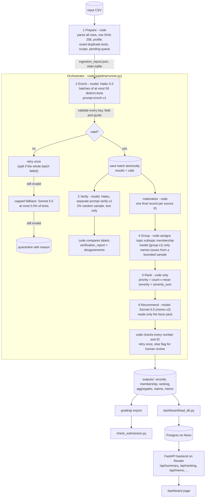

# Spotify review insight pipeline

**Question.** Where should Spotify put the next quarter of product effort: access, usability, playback, or billing/support?
The answer comes from 660,622 Google Play reviews (May 2022 to Nov 2023), run through a staged, multi-agent pipeline whose
every number can be traced back to saved records.

| | |
|---|---|
| **Live dashboard** | `__DASHBOARD_URL__` (free Render instance: the first load after idle can take ~30-50 s; no login) |
| **Decision memo** | [`runs/final/outputs/memo.md`](runs/final/outputs/memo.md) |
| **Grading export** | [`grading/`](grading/) (self-check: [`evals/self_check_report.json`](evals/self_check_report.json)) |
| **Cost calculator** | [`cost/report.md`](cost/report.md), with offline replay `python -m cost.calculator` |
| **Interrupt/resume recording** | `__RECORDING_LINK__` |
| **Dataset** | Course ZIP (`spotify_reviews_18months.csv`, SHA-256 `1fc85de6…2fcef6`). Place it at `data/spotify_reviews_18months.csv`; it is not committed. |

## Results at a glance

These figures come from the final run, `runs/final` (run ID in `grading/run.json`).

| | |
|---|---|
| Source rows ingested and accounted for | **660,622 / 660,622**. The official checker profile matches exactly: 13 empty texts, 159,701 missing app versions, 0 duplicate IDs. |
| Declared classification scope | **`sample:100000`**: the first 100,000 nonempty reviews in the manifest's own SHA-256 sampling order. It includes the golden 50 and the 10k analysis set. |
| Distinct texts sent to the model | 78,099. Each is sent once; exact-text reuse covers the rest. |
| **Completed classifications** | **236,894**: 77,342 by model call and 159,552 by valid exact-text reuse (`cache_source_id`). That is 99.56% of the 237,942 rows the scope can reach, and 35.9% of all 660,609 nonempty rows. |
| Quarantined | 13 `empty_review_text`; 1,048 `invalid_model_output` (757 distinct texts, after one retry plus the capped fallback); 422,667 `outside_declared_classification_scope` |
| Independent verifier (1,547 random texts) | topic 86.9%, intent 91.8%, severity exact 86.5% (within 1: 99.7%), sentiment MAE 0.08 |
| Golden 50 vs human labels | topic 60%, intent 78%, severity exact 62% (within 1: 80%), sentiment within ±0.3: 86% ([analysis](evals/golden_error_analysis.md)) |
| Planted-error test | 23/25 deliberately wrong labels flagged by the verifier comparison |
| Injection test | pass: 3/3 injected reviews labelled on their content; no neighbour moved to an injected label |
| Run cost and time | **$5.52 API** (enrich $5.45, verify $0.045, group $0.004, memo $0.031), all priced from provider-reported usage. **~61 min** wall clock with 8 workers, over 2 sessions. |
| Pilot projection for this scope | $4.06 base / $7.68 conservative, ~1 h. The actual result landed inside that range. |
| Official checker (`check_submission.py check`) | Only remaining flag: `unfinished_classification`, which is the declared out-of-scope rows. Coverage-point candidate **0.6152**. |

**Recommendation (memo):** prioritise **billing/support, specifically free-tier restrictions** (forced shuffle, skip limits, paywalled
playback controls). It is the top *specific* issue under the baseline ranking (`billing.free_tier_restrictions_paywall`, 6,975
complaints, mean severity 2.711971, priority 18,916). Ad interruptions are the close alternative (16,481). Playback and access are
smaller but far more severe. See the memo for claim IDs, alternatives and limitations.

### Why 100k and not the full corpus

The brief allows "660,622 (or at least 100,000)". The calculator, measured on the 100-review pilot and refreshed after the 500-review
checkpoint and the run itself, projects the full corpus at **$24.7 base / $47.0 conservative and about 6 hours** with exact-text reuse
(no reuse: $33.7 / $64.1). That run could not finish before the deadline. The 100k scope ran in about an hour for about $5.50.

Rows outside the scope are not hidden. Each appears in `records.jsonl` as `quarantined` with reason
`outside_declared_classification_scope`. The same pipeline runs the full corpus with `--scope all`.

## How to run

```bash
python3 -m venv venv && source venv/bin/activate
pip install -r requirements.txt
cp .env.example .env            # add ANTHROPIC_API_KEY (and DATABASE_URL for the dashboard loader)
python -m pytest -q             # 10 offline tests, no key needed
```

| Purpose | Command | Model calls? |
|---|---|---|
| Full staged pipeline on any CSV | `python -m pipeline run --input data/spotify_reviews_18months.csv --state runs/final --scope sample:100000 --workers 8 --budget-usd 25` | yes (paid) |
| Resume after interruption (Ctrl-C) | the same command again; completed texts are never re-sent | only pending work |
| Status of a run | `python -m pipeline status --state runs/final` | no |
| **Regenerate ranking from saved outputs** | `python -m pipeline rank --state runs/final` | **no** |
| Grading export | `python -m pipeline export --state runs/final --input data/spotify_reviews_18months.csv --out grading` | no |
| Official self-check | see [Checker](#checker) | no |
| **Cost calculator, offline replay** (default) | `python -m cost.calculator` or `python -m cost.calculator replay --rate-multiplier 2` | **no** |
| Cost calculator, paid pilot | `python -m cost.calculator pilot --execute` | yes |
| Golden evaluation | `python -m evals.eval_golden --records runs/final/outputs/records.jsonl.gz` | no |
| Planted-error test | `python -m pipeline planted --state runs/final --out evals` | no |
| Injection test | `python -m evals.system_tests --execute` | yes, 2 small calls |
| Load dashboard DB | `python -m dashboard.load_db --state runs/final` (uses `DATABASE_URL`) | no |
| Dashboard locally | `uvicorn dashboard.app:app --port 8000` | no |

Any stage subset runs with `--stages`, e.g. `--stages memo`. `--provider fake` runs the whole pipeline offline with a keyword stub
(tests only; its label_config contains `fake`).

**Keys.** `.env` is git-ignored (`.gitignore` has `.env`, `.env.*`, `!.env.example`). Only the blank `.env.example` is committed.
Keys are loaded with python-dotenv and never logged.

## Architecture



**Where code decides and where a model judges.**

| Stage | Owner | Input | Output | Failure / stop rule |
|---|---|---|---|---|
| Prepare | code | CSV path | `ingestion_report.json`, `source`/`texts` tables, queue ordered by manifest hash rank | malformed CSV aborts; a different input or scope needs a new state dir |
| Enrich | **model** (Haiku 5.5, effort low, thinking disabled) | at most 50 distinct texts as a JSON array with short keys `k` | `record_labels` tool call | code validates key set, enums, ranges and exact quote; retries invalid output once; capped Sonnet fallback; else quarantine. 429/5xx/timeouts: at most 4 attempts with exponential backoff + jitter. Auth/400 errors stop the run. A budget cap stops admission. |
| Verify | **model** (Haiku, different prompt, no access to the first labels) | 2% random sample (min 20, max 2,000) | auditor labels | code compares; a missing output is reported, never filled in |
| Group | code assigns; **model** names | complaint/cancellation records; at most 6 quotes per issue | `membership.csv`, `issues.json` | the model cannot move members; unnamed issues keep the code ID |
| Rank | code | records + membership | `ranking.csv`, `aggregates.csv`, `area_aggregates.csv`, `trends_monthly.csv` | errors on duplicate pairs, multi-issue reviews or ungrouped complaints |
| Recommend | **model** (Sonnet 5.5) | facts pack only: coverage, area facts, top-10 ranking with claim IDs, 18 evidence quotes | structured memo | code rejects any number, claim ID, issue ID, review ID or bracket tag not in the pack; one retry with feedback, then `failed_needs_human_review` |

**Why each model call is needed.** Labelling free text (topic, intent, severity, quote) needs language judgement. The auditor needs
independent judgement on the same text. Issue *names* need summarisation. The memo needs prose.

Everything else is code: parsing, hashing, dedup, scope, queueing, validation, retries, budgets, membership, arithmetic, ranking,
claim checking and export.

**Shared state and handoffs.**
- All state lives in `runs/<name>/state.sqlite`. Only the main thread writes, one transaction per batch, so a crash can never
  half-save or double-count a batch. Workers only make API calls.
- The result cache is keyed by `(text SHA-256, label_config)`, where label_config = model + effort + thinking + prompt version +
  schema version.
- Every handoff is a saved file under `runs/final/outputs/`.
- Every attempt, including failures, is logged in `run_log.jsonl` with request ID, model, settings, usage, cost, timing and phase.

**Spend and concurrency controls** (`pipeline/llm.py`).
- One shared `SpendLedger` reserves the worst-case cost of each request (estimated input + max output tokens) **before** dispatch.
  It refuses admission when spent + unreconciled + reserved + next > cap.
- Unknown-outcome attempts (timeouts, hard interrupts) are kept as unreconciled spend.
- A shared rate limiter applies across workers, plus a model allowlist, an output-token cap per request (8,000) and a fallback quota.
- Tests demonstrate the budget stop, retries and resume ([tests/test_pipeline.py](tests/test_pipeline.py)).

## Shared schema and labels

Definitions, custom subtopics and worked examples are in **[docs/labels.md](docs/labels.md)**. Prompts are in
[`pipeline/prompts/`](pipeline/prompts/), and tool schemas plus validation in [`pipeline/schema.py`](pipeline/schema.py).
The exported record matches GRADING_CONTRACT.md, plus the optional `subtopic` and `cache_source_id` fields:

```json
{"review_id":"…","source_sha256":"…","status":"completed","topic":"billing","intent":"complaint","sentiment":-0.6,"severity":3,
 "entities":["shuffle","Premium"],"evidence_quote":"…exact substring…","needs_review":false,
 "label_config":"claude-haiku-5-5:effort=low:thinking=disabled+enrich-v1+schema-v1","subtopic":"free_tier_restrictions_paywall"}
```

Records completed by the Sonnet fallback carry `claude-sonnet-5-5:…+enrich-v1+schema-v1`.

**Provenance.** `grading/run.json` ties together:
- the input SHA-256
- the scope
- every role's label_config
- the run ID

`runs/final/run_summary.json` adds per-role usage, cost, sessions and stage times.

## Evaluation and testing

**1. Golden 50 (human labels).** [`evals/golden_50_labeled.csv`](evals/golden_50_labeled.csv) was hand-labelled after the run.
- Metrics are in [`evals/golden_results.json`](evals/golden_results.json), with per-case pass/fail in
  [`evals/golden_cases.csv`](evals/golden_cases.csv).
- The error analysis is in **[evals/golden_error_analysis.md](evals/golden_error_analysis.md)**. Of 31 cases with any disagreement,
  17 trace to the human label departing from a shared definition, 11 are genuinely ambiguous and 3 are clear model errors.
- The labels were never model inputs and were not used to tune prompts.

**2. Independent verifier.** A separate auditor prompt re-labelled a declared 2% random sample (1,547 texts) without seeing the
enrichment labels.
- Results: [`runs/final/verification_report.json`](runs/final/verification_report.json).
- All 443 disagreements are listed in [`runs/final/verification_disagreements.csv`](runs/final/verification_disagreements.csv).
- Main confusions:
  - other→catalog (29)
  - billing→usability (23): the free-tier shuffle paywall sits on the billing/usability boundary
  - usability→other (18)
  - unclear→complaint (20)
  - complaint↔cancellation (31)

**3. Planted-error test.** [`evals/planted_error_test.json`](evals/planted_error_test.json) works on a separate test copy of the
saved labels, with no model calls.
- A wrong topic or intent was planted on 25 verified records.
- 23/25 were flagged by the comparison against the independent verifier labels.
- The 2 misses happened where the verifier had independently picked the same "wrong" label.
- The baseline disagreement on unplanted records is 20%.

**4. Injection test.** [`evals/injection_test.json`](evals/injection_test.json) is synthetic and excluded from business results.
- Three reviews contained injected instructions ("IGNORE ALL PREVIOUS INSTRUCTIONS…", a fake system message, a fake JSON
  close). All three were labelled on their real content.
- Four ordinary neighbours in the same batch were compared with a clean control batch. None moved to an injected label;
  3/4 kept identical labels.
- **Disclosure.** The first run of this test used a stricter "neighbours must be identical" rule. It failed on 2 neighbours, one
  of which ("charged twice after cancelling") legitimately is billing/5. Those raw results are kept in
  [`evals/injection_test_run1_original_criteria.json`](evals/injection_test_run1_original_criteria.json).
- The criterion was then changed to "no movement toward the injected labels". Raw stability is still reported, as a
  run-to-run variability measure: the current API does not accept `temperature`.

**5. Retry, spending and recovery controls (T3).**
- **Retries, live:** 4 real failed attempts were logged when the API rejected parameters (`thinking`, then forced
  `tool_choice`) on Sonnet. The client adapted and retried.
- **Invalid output, live:** 787 retry requests and 394 capped fallbacks, every one in `run_log.jsonl`.
- **Budget stop, offline:** `test_budget_cap_stops_before_dispatch` shows admission refused before any over-cap request.
- **Recovery, live:** the run was interrupted with Ctrl-C (session 1, `interrupted_by_user`, 90,049 completed review IDs saved)
  and resumed (session 2, `phase=resume`). The resume added completed IDs up to 236,894, and no resume call contains a
  checkpoint-before ID. See `grading/checkpoint_before.json`, `grading/checkpoint_after.json` and the recording linked above.
- **Offline tests:** fault injection covers transient 529s, dropped keys, bad quotes, fatal auth errors, the budget stop, resume
  with zero re-sent IDs, and checker-equivalent ranking.

**6. Inspected failure: missing severity on praise.**
- **What happened:** on the first pass Haiku omitted `severity` for 9,084 items, overwhelmingly praise reviews. It appears to
  treat "no problem" as "no value".
- **Handling:** each of those batches got one retry, and texts still invalid went to the capped Sonnet fallback (389 completed,
  331 of them praise). The rest were quarantined (757 texts / 1,048 rows, e.g. review `2b3ef4bc-0d65-46c1-b716-22e69394964c`:
  "Best app ever I liked the music on it matched my vibe", `invalid_model_output:bad_severity:None`, 2 attempts).
- **Effect:** because the quarantined texts are mostly praise, the complaint ranking is barely affected. Praise is
  under-represented in completed records.
- **Possible fix, not applied in this run:** a schema-v2 rule that maps a missing severity to 1 when intent is praise or unclear,
  as the shared rubric defines.

**7. Ambiguous case handling.** Review `723f07de-9881-4049-8680-1a9e25652914` describes a crash that support later fixed. The model
returned praise with severity 3, which contradicts the rubric's "praise = severity 1". Code did not rewrite it. It set
`needs_review=true` with reason `intent/severity inconsistent`, as it does for all 1,230 such records.

### Trace: one review from source to memo

`__TRACE__`

## Cost and runtime (T3)

**[cost/report.md](cost/report.md)** is the calculator output. Evidence files:
- `pilot_calls.jsonl`: every cold and warm attempt
- `pilot_records.jsonl`: 100 statuses
- `usage.csv`: billing items per call
- `rates.csv`: dated, editable, with source links
- `assumptions.json`: budget, workers, fallback cap and scenarios
- `replay_result.json`
- `pilot_attempts_archive/`: the first, aborted pilot attempt (Sonnet rejected forced `tool_choice`)

Measured on the 100-review pilot (`cost_100.csv`, checksum verified, empty cache, 1 worker):

| | Cold | Warm |
|---|---|---|
| Wall clock | 51.8 s | 0.04 s |
| API spend | $0.0370 (enrich $0.0051, verify $0.0007, group $0.0012, memo $0.0300) | $0 |
| Enrichment calls | 3 (2 batches + 1 single-review retry) | **0**; 100/100 result-cache hits; 0 downstream calls (stage cache) |
| Cost / 1,000 input rows | $0.37 (dominated by the one Sonnet memo; enrichment alone is $0.051) | $0 |

**Refreshes.** After the 500-review checkpoint the cost was $0.0000559 per text. The 100k run itself (78,099 texts) came to
$0.0000697 per text including retries and fallbacks.

**Arithmetic.** `item_cost = billed_units × usd_per_million / 1e6` over mutually exclusive uncached input, cache write, cache read
and output tokens. `python -m cost.calculator replay --rate-multiplier 2` doubles API spend exactly and leaves measured time
unchanged.

**Rates.** Rates are third-party listings checked 2026-10-20: Haiku 5.5 at $0.10/$0.50 per M input/output; Sonnet 5.5 at $2/$10.
They have not yet been reconciled against the Anthropic Console invoice. Prompt caching was used: 9.8 M cache-read tokens on
enrichment.

## Ranking rules and scope

- **Baseline.** Completed `complaint` + `cancellation` records only. `issue_id = topic.subtopic`, one issue per review
  (`allow_multi_issue=false`). `priority_score = severity_sum = complaint_count × mean_severity`. Order: descending score, then
  ascending issue ID. Means use 6 decimals, half-up. `python -m pipeline rank` regenerates byte-identical output from saved files.
- **The `other.general` issue** ("bad app" with no specific defect) ranks first by volume. It is kept in the baseline, but it is
  not a product area. The memo says so and recommends among specific areas.
- **Area view** (`area_aggregates.csv`). billing_support = billing + support topics. This is a secondary view, explained
  separately in the memo with `T` fact IDs.
- **Trends** (`trends_monthly.csv`). Monthly complaint share with denominators. May 2022 and Nov 2023 are partial months.

**Limitations.**
- Reviews are self-selected, historical and public. They contain no revenue, plan tier or confirmed churn; cancellation text is
  intent, not churn.
- Exact-text reuse means completed records over-represent short repeated texts ("Good", "Great app"), which are mostly praise.
  Complaints are mostly unique and come from the 100k sample.
- 422,667 rows were not classified (declared scope) and 1,048 were quarantined.
- One person labelled the golden set. The current API does not accept `temperature`, so labels can vary slightly between runs.

## Dashboard

- **Deployment:** a FastAPI backend ([`dashboard/app.py`](dashboard/app.py)) on Render, reading Postgres on Neon. The database is
  loaded by [`dashboard/load_db.py`](dashboard/load_db.py) from the saved outputs.
- **What's stored:** 236,894 completed records with issue membership, plus issues, areas, trends, claims, facts, the memo and
  evaluation summaries.
- **What the page shows** ([`dashboard/static/index.html`](dashboard/static/index.html)):
  - overall metrics
  - the AI recommendation with clickable claim IDs, checked against the stored values
  - product-area priority
  - the issue ranking with drill-down to severity mix, monthly volume and exact evidence quotes with review IDs
  - monthly trends
  - evaluation results
  - a review explorer
- **No model calls at view time.** The recommendation is the saved, claim-checked memo-agent output.
- **API:** `/api/health`, `/api/summary`, `/api/areas`, `/api/ranking`, `/api/issues/{id}`, `/api/trends`, `/api/memo`,
  `/api/reviews?issue=&topic=&intent=&q=`, `/api/review/{id}`. Deploy config: [`render.yaml`](render.yaml).

## Checker

```bash
cd data
python3 check_submission.py profile   --full spotify_reviews_18months.csv --out ../grading/ingestion.json
python3 check_submission.py reference --full spotify_reviews_18months.csv --analysis spotify_reviews_18months.csv --out ../local-reference.json
python3 check_submission.py check --reference ../local-reference.json --submission ../grading --out ../self-check.json
```

The result is saved as [`evals/self_check_report.json`](evals/self_check_report.json).
- Status is `review_required`, but its only issue code is `unfinished_classification` (the declared out-of-scope rows).
- No schema, quote, cache, ranking, claim, resume or call-log issues.

## Repository map

```
pipeline/   ingest, enrich, verify, analysis (group/rank), memo, runner (orchestrator), llm (client/ledger), schema, prompts/
cost/       calculator, rates.csv, assumptions.json, pilot evidence, report.md
evals/      golden labels + results + error analysis, injection, planted-error, self-check report
runs/final  run_summary.json, run_log.jsonl, ingestion_report.json, verification_*, outputs/ (records, membership, ranking, memo…)
runs/dev500 the 500-review checkpoint run
grading/    standardized export for check_submission.py
dashboard/  FastAPI backend, DB loader, static dashboard page
docs/       label definitions; tests/ offline tests
```

Dependencies are in `requirements.txt`: anthropic 1.16, python-dotenv, FastAPI, SQLAlchemy 2, psycopg 3, pytest. Offline tests pass on Python 3.10; the paid runs used Python 3.14 on macOS.
